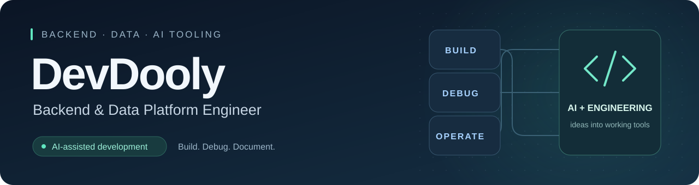

  

  <a href="#개발-역량"><strong>개발 역량</strong></a>
  &nbsp; · &nbsp;
  <a href="#ai와-함께-진행한-프로젝트"><strong>AI 프로젝트</strong></a>
  &nbsp; · &nbsp;
  <a href="https://devdooly.github.io/TIL/"><strong>기술 위키</strong></a>
  &nbsp; · &nbsp;
  <a href="mailto:sunhongyi@gmail.com"><strong>이메일</strong></a>

Java·Spring Boot 기반 서비스와 데이터 파이프라인을 개발하는 **DevDooly**입니다. Kubernetes·MinIO 환경을 운영하며, Helm 차트 작성과 배포, Kafka 오류 분석과 개선을 함께 담당합니다.

업무에서 다룬 기술과 문제 해결 경험은 **개발 역량**에, AI와 함께 만든 앱·웹 서비스·개발 도구는 **AI 프로젝트**에 모았습니다.

## 개발 역량

### 서비스 개발·데이터 처리·운영

| 경험 범위 | 다루는 기술과 역할 |
| :--- | :--- |
| **백엔드 실무** | Java 21 · Spring Boot · Jdbi · Kafka · SQL |
| **배포와 운영** | Kubernetes · Helm · Jenkins · Argo CD · MinIO · Docker · Linux · Ansible |
| **데이터 플랫폼** | Hadoop · Hive · Tez · Trino · Iceberg · Spark · Airflow |
| **개인 프로젝트** | Python · FastAPI · Kotlin · Android · TypeScript |

### 업무에 AI를 적용한 경험

- **알고리즘 개선** — 반도체 수율 개선을 위한 수학 연산 로직을 LLM으로 분석하고 시간복잡도를 낮췄습니다.
- **레거시 오류 수정** — 시간 동기화와 관련된 오류를 발견하고 수정했습니다.
- **코드 정비** — 프로젝트 구조를 개선하고 코딩 스타일과 구현 방식을 일관되게 정리했습니다.

[LLM을 활용한 레거시 개선 기록](https://devdooly.github.io/TIL/LLM_Development/Legacy_Code_Improvement/) · [Kafka Producer 파티셔너 이슈](https://devdooly.github.io/TIL/Infrastructure/MessageBroker/Kafka/Producer_Partitioner_Issue/) · [MinIO 버전 보존과 객체 삭제](https://devdooly.github.io/TIL/Infrastructure/MinIO/MinIO_Versioning_Deletion_Issue/)

### 설계와 검증 과정을 설명하는 개인 Lab

회사 코드·데이터를 사용하지 않는 개인 프로젝트입니다. 합성 센서 데이터로 처리·배포·복구 과정을 재현하고, 선택한 기술과 실패 이후의 동작을 설명합니다.

| 사례 | 설명하는 내용 |
| :--- | :--- |
| **[Kafka 재전달](https://devdooly.github.io/devdooly-platform-lab/cases/kafka-redelivery/)** | ACK·DB commit·offset commit 사이의 중단과 재전달 이후 결과를 대조합니다. |
| **[CI/CD·GitOps](https://devdooly.github.io/devdooly-platform-lab/cases/cicd-delivery/)** | Jenkins·Actions 검증부터 이미지 게시·Argo CD 배포까지 연결하고, 실패 차단과 이전 이미지 복귀를 확인합니다. |
| **[MariaDB·Garage S3 복구](https://devdooly.github.io/devdooly-platform-lab/cases/storage-recovery/)** | DB 처리 완료와 결과 파일의 전체 검증을 나누고, 중단·손상 이후의 재개 조건을 확인합니다. |

[기술을 이해하고 수정하는 문서](https://devdooly.github.io/devdooly-platform-lab/handbook/) · [검증 근거 찾아보기](https://devdooly.github.io/devdooly-platform-lab/#evidence)

기존 Lab에서 공개한 처리·관측·복원 기록

합성 센서 데이터의 처리 결과와 실패 사유를 조회하고, 구현·테스트·배포의 근거를 함께 공개합니다. 아래 링크는 각 실행 당시의 조건과 결과를 담고 있습니다.

- **데이터 처리와 export** — Java·Spring Boot·MariaDB, Kafka 작업 처리와 결과·실패 파일 export
- **빌드와 배포 기록** — [같은 소스 검증·이미지 게시, 실패 차단·이전 이미지 복구](https://github.com/DevDooly/devdooly-platform-lab/blob/main/docs/evidence/cicd-gate/README.md)
- **주기 관측** — [30분 주기·자연 실행 2회](https://github.com/DevDooly/devdooly-platform-lab/blob/main/docs/evidence/kafka-observation/README.md)와 당시 공개 기록을 대조
- **복원** — MariaDB 논리 복원과 [Kafka·Garage의 격리 PVC 복원](https://github.com/DevDooly/devdooly-platform-lab/blob/main/docs/evidence/runtime-pvc-restore/README.md)
- **공개 연결** — [내부 게이트웨이 접근 대조](https://github.com/DevDooly/devdooly-platform-lab/blob/main/docs/evidence/public-read-gateway-internal/README.md)와 [표준 CA·SNI TLS, 외부 runner GET·거부 검증](https://github.com/DevDooly/devdooly-platform-lab/blob/main/docs/evidence/public-read-https/README.md)
- **스냅샷 만료** — [격리 Cloud의 합성 데이터 한 번](https://github.com/DevDooly/devdooly-platform-lab/blob/main/docs/evidence/cloud-iceberg-expiration/README.md)에서 snapshot 4개·전체 객체 25개 → snapshot 3개·전체 객체 23개, tag와 남은 snapshot의 공유 파일 보존

[작업 관측 화면](https://devdooly.github.io/devdooly-platform-lab/#job-observation)과 [스냅샷 전후 비교](https://devdooly.github.io/devdooly-platform-lab/#snapshot-expiration)에서 출처·수집 시각·원래 근거를 함께 확인할 수 있습니다.

## AI와 함께 진행한 프로젝트

필요한 기능과 범위를 정하고 AI와 구현·실험·문서화를 진행한 개인 프로젝트입니다. 공개 구현과 배포물, 검증 기록, 진행 중인 항목을 프로젝트별로 안내합니다.

### Slivue · 슬리뷰

**현재 화면에서 알림을 확인하고 답장하는 Android 앱**

앱을 전환하지 않고 화면 가장자리의 패널에서 최근 알림을 확인합니다. 답장을 지원하는 앱에는 패널에서 바로 답장할 수 있고, Good Lock 제스처와도 연결합니다. Kotlin·Jetpack Compose·알림 접근·오버레이를 사용합니다.

AI 에이전트용 작업 지침과 오버레이·성능·테스트·릴리스 스킬을 공개했습니다. GitHub에서 APK를 제공하며, Google Play 출시는 준비 단계입니다.

[프로젝트·설치 안내](https://github.com/DevDooly/Slivue) · [릴리스](https://github.com/DevDooly/Slivue/releases) · [개발 문서](https://github.com/DevDooly/Slivue/blob/main/docs/DEVELOPMENT_REFERENCE.md) · [AI 작업 지침](https://github.com/DevDooly/Slivue/blob/main/AGENTS.md)

### 모임포켓 · Moim-Pocket

**계모임의 회비·장부·일정·사진을 관리하는 모바일 웹**

회비 납부 현황과 입출금 장부, 일정·투표, 사진 앨범과 게시판을 한곳에서 관리합니다. 총무 기능과 SQLite 백업·복원도 포함합니다. Next.js·TypeScript·Prisma·SQLite를 사용하며 Docker Compose 실행 방법을 공개했습니다.

AI와 진행한 계모임 페이지를 서비스 프로젝트로 정리했습니다. 공개 저장소에서 기능과 실행 방법을 확인할 수 있습니다.

[프로젝트·실행 안내](https://github.com/DevDooly/moim-pocket) · [구현 소스](https://github.com/DevDooly/moim-pocket/tree/main/src) · [데이터 구조](https://github.com/DevDooly/moim-pocket/blob/main/prisma/schema.prisma)

### Platform Lab · 서비스부터 플랫폼 구축까지

**Java 데이터 처리, 배포·복구 사례와 서버 재구축을 연결한 개인 Lab**

Java·Spring Boot·MariaDB·Kafka·Garage S3와 웹을 연결하고, Jenkins·GitHub Actions·Argo CD·K3s로 빌드·게시·배포 과정을 다뤘습니다. AI와 함께 구현·검증·문서화를 진행했으며, 기술별 설명과 실행 근거를 공개합니다.

기존 Lab의 공개 사례와 별도 Ubuntu VM의 CI/CD 실행 기록이 있습니다. **새 VM 전체 설치기와 Grafana 서비스 상태·실제 로그 검증은 진행 중**입니다. 해당 작업은 [PR #309](https://github.com/DevDooly/devdooly-platform-lab/pull/309)에서 이어갑니다.

[포트폴리오](https://devdooly.github.io/devdooly-platform-lab/) · [기술 문서](https://devdooly.github.io/devdooly-platform-lab/handbook/) · [소스·현재 범위](https://github.com/DevDooly/devdooly-platform-lab) · [별도 VM CI/CD 기록](https://github.com/DevDooly/devdooly-platform-lab-vm-cicd)

### 추가로 만든 도구와 실험

AI 개발을 위한 도구와 함께 살펴볼 수 있는 개인 앱·실험도 모았습니다.

| 프로젝트 | 목적과 현재 범위 |
| :--- | :--- |
| **[Thumbbridge · 썸브릿지](https://github.com/DevDooly/Thumbbridge)** | 가까운 보조 버튼으로 화면의 지정 위치를 누르는 Android 접근성 앱입니다. Kotlin·Android View·DataStore를 사용하며, [구현·검증 기록](https://github.com/DevDooly/Thumbbridge/blob/main/docs/DEVELOPMENT.md)과 개발용 debug APK를 제공합니다. |
| **[llm-dev-cli](https://github.com/DevDooly/llm-dev-cli)** | AI 프로젝트의 초기 문서·룰셋 생성, 설정 정적 점검, 체크리스트와 로컬 대시보드를 연결합니다. Python·FastAPI CLI의 `init` · `doctor` · `status` · `view` 명령을 제공합니다. |
| **[AI Playground](https://github.com/DevDooly/ai-playground)** | Gemini CLI·AI 코딩 규칙·로컬 Kubernetes·LLM 개발 환경을 실험합니다. [AI 게시판](https://github.com/DevDooly/ai-playground/tree/main/ai-board)과 [개발 가이드](https://github.com/DevDooly/ai-playground/tree/main/llm-development)를 포함합니다. |
| **[Nasdaq is God](https://github.com/DevDooly/nasdaq-is-god)** | 주가 데이터의 백테스트와 뉴스·소셜 감성 분석을 함께 실험합니다. FastAPI·Flutter Web·PostgreSQL과 Gemini·Ollama를 다루며 [구현 상태](https://github.com/DevDooly/nasdaq-is-god/blob/main/PROJECT_STATUS.md)를 공개합니다. |
| **[PyBridge](https://github.com/DevDooly/PyBridge)** | CSV 검증 API와 Python 가상환경 준비·실행·중지·점검 스크립트를 묶은 FastAPI 서버입니다. [Gemini 개발 지침](https://github.com/DevDooly/PyBridge/blob/main/GEMINI.md)을 포함합니다. |
| **[Java UTC 구간 계산](https://github.com/DevDooly/devdooly-platform-lab/tree/main/examples/java-window-analysis)** | AI가 제안한 O(n²)·O(n log n) 구현을 합성 계약·독립 oracle·경계 테스트·JMH로 비교했습니다. [AI 활용 범위](https://github.com/DevDooly/devdooly-platform-lab/blob/main/examples/java-window-analysis/PROVENANCE.md)를 공개했고, [소유자 검토는 대기 중](https://github.com/DevDooly/devdooly-platform-lab/blob/main/docs/reviews/ai-window-owner-review.md)입니다. |

**기획 단계 — [RoadWitness](https://github.com/DevDooly/road-witness)**

주행 영상의 의심 장면을 검토하고 신고를 준비하는 Android·기기 내 AI 흐름을 설계했습니다. 현재 공개 범위는 기획·구조 문서·합성 예시이며, 실행 앱과 학습 모델은 준비 전입니다.

### 함께 보는 저장소와 기술 기록

[Spring Boot 멀티 모듈 템플릿](https://github.com/DevDooly/spring-skeleton) · [nasdaq-is-god](https://github.com/DevDooly/nasdaq-is-god) · [TIL 기술 위키](https://devdooly.github.io/TIL/) · [전체 공개 저장소](https://github.com/DevDooly?tab=repositories)

  <a href="#개발-역량">개발 역량으로 ↑</a>
  &nbsp; · &nbsp;
  <a href="https://devdooly.github.io/TIL/">기술 기록 읽기</a>
  &nbsp; · &nbsp;
  <a href="mailto:sunhongyi@gmail.com">sunhongyi@gmail.com</a>

