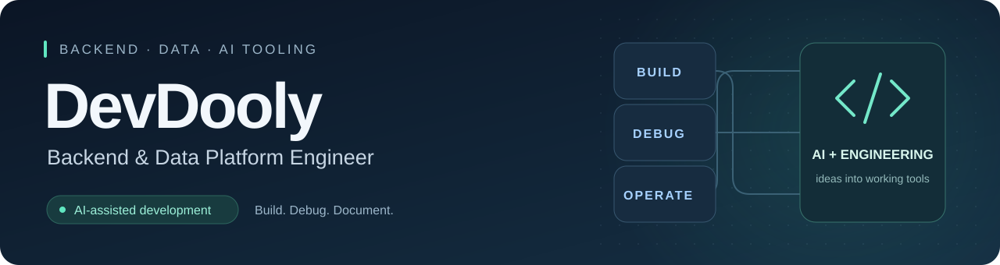
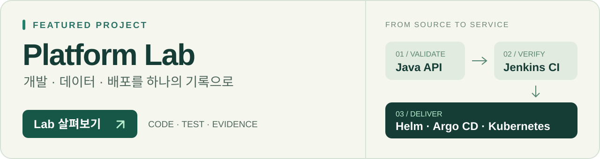

  

  <a href="https://devdooly.github.io/devdooly-platform-lab/"><strong>Platform Lab ↗</strong></a>
  &nbsp; · &nbsp;
  <a href="https://devdooly.github.io/TIL/"><strong>기술 위키</strong></a>
  &nbsp; · &nbsp;
  <a href="https://github.com/DevDooly/llm-dev-cli"><strong>AI 개발 도구</strong></a>
  &nbsp; · &nbsp;
  <a href="mailto:sunhongyi@gmail.com"><strong>이메일</strong></a>

## 만들고 개선한 과정을 기록합니다

Java·Spring Boot 기반 서비스와 데이터 파이프라인을 개발하는 **DevDooly**입니다. Kubernetes·MinIO 환경을 운영하며, Helm 차트 작성과 배포, Kafka 오류 분석과 개선을 함께 담당합니다.

최근에는 **LLM을 활용한 레거시 코드 개선**과 **개발 도구 자동화**에 집중하고 있습니다. 실무에서 쌓은 경험은 개인 Platform Lab으로 재현하고, 기술적인 판단과 문제 해결 과정은 TIL에 남깁니다. CLI와 Android 앱도 만들고 있습니다.

## 직접 확인할 수 있는 Platform Lab

  

**[포트폴리오와 Lab 열기 →](https://devdooly.github.io/devdooly-platform-lab/)** · [소스와 설계](https://github.com/DevDooly/devdooly-platform-lab) · [다음 개발 계획](https://github.com/DevDooly/devdooly-platform-lab/blob/main/docs/NEXT_STEPS.md)

회사 코드·데이터를 사용하지 않는 개인 프로젝트입니다. 합성 센서 데이터의 처리 결과와 실패 사유를 조회하고, 구현·테스트·배포의 근거를 함께 공개합니다.

| 확인할 수 있는 것 | 구현과 검증 |
| :--- | :--- |
| **데이터 처리와 export** | Java·Spring Boot·MariaDB, Kafka 작업 처리와 결과·실패 파일 export |
| **빌드와 배포 기록** | Jenkins·Actions의 같은 소스 검증·이미지 게시, Argo CD·Helm 배포와 실패 차단·이전 이미지 복구 |
| **복원과 관측 근거** | [30분 주기·자연 실행 2회](https://github.com/DevDooly/devdooly-platform-lab/blob/main/docs/evidence/kafka-observation/README.md) · [CI/CD 검증](https://github.com/DevDooly/devdooly-platform-lab/blob/main/docs/evidence/cicd-gate/README.md) · [Kafka·Garage 격리 복원](https://github.com/DevDooly/devdooly-platform-lab/blob/main/docs/evidence/runtime-pvc-restore/README.md) |

공개 화면은 **30분 주기로 수집·게시하는 미니 PC의 마지막 관측 기록**을 표시합니다. 원래 타이머의 자연 실행 2회와 각 회차의 공개 기록을 대조했고, MariaDB 논리 복원과 Kafka·Garage의 격리 PVC 복원도 확인했습니다.

[내부 게이트웨이](https://github.com/DevDooly/devdooly-platform-lab/blob/main/docs/evidence/public-read-gateway-internal/README.md)에서는 조회 6개와 제한 요청 3개, 접근 대조·임시 자원 정리·기존 상태 보존을 확인했습니다. 연결 거절이 NetworkPolicy만의 결과인지는 확인하지 않았으며, 외부 HTTPS와 공개 화면의 실시간 API 연결은 다음 단계입니다.

### 다음으로 구현할 것

1. **공개 조회 연결** — 외부 HTTPS와 조회 게이트웨이를 포트폴리오 화면에 연결
2. **운영과 복구 확장** — 자격증명 회전·장기간 운영, Jenkins·K3s 전체 복원 검증
3. **개선 사례 정리** — Java·데이터·AI 개선의 전후 측정과 기술적인 판단 공개

[단계별 결과물과 완료 조건 보기 →](https://github.com/DevDooly/devdooly-platform-lab/blob/main/docs/NEXT_STEPS.md)

## 최근 AI 활용

- **알고리즘 개선** — 반도체 수율 개선을 위한 수학 연산 로직을 LLM으로 분석하고 시간복잡도를 낮췄습니다.
- **레거시 오류 수정** — 시간 동기화와 관련된 오류를 발견하고 수정했습니다.
- **코드 정비** — 프로젝트 구조를 개선하고 코딩 스타일과 구현 방식을 일관되게 정리했습니다.

[LLM을 활용한 레거시 개선 기록 읽기 →](https://devdooly.github.io/TIL/LLM_Development/Legacy_Code_Improvement/)

## 만드는 도구와 프로젝트

공개 저장소에서 개발 도구, 서비스 구조, 학습 기록을 이어가고 있습니다.

<table>
  <tr>
    <td width="50%" valign="top">
      <h3><a href="https://github.com/DevDooly/llm-dev-cli">llm-dev-cli</a></h3>
      
<strong>LLM 프로젝트용 개발 도구</strong>

      
템플릿 생성, 설정의 정적 점검, 체크리스트 진행 상태와 로컬 대시보드를 제공합니다.

      
<code>init</code> <code>doctor</code> <code>status</code> <code>view</code>

      
Python · FastAPI · CLI

    </td>
    <td width="50%" valign="top">
      <h3><a href="https://github.com/DevDooly/ai-playground">ai-playground</a></h3>
      
<strong>AI 개발 가이드와 서비스 실험</strong>

      
AI 코딩 규칙, 로깅·컨테이너 구성, LLM 개발 가이드와 AI 게시판 예제를 모았습니다.

      
<a href="https://github.com/DevDooly/ai-playground/tree/main/llm-development">개발 가이드</a> · <a href="https://github.com/DevDooly/ai-playground/tree/main/ai-board">AI 게시판</a>

      
Python · FastAPI · TypeScript · Docker

    </td>
  </tr>
  <tr>
    <td width="50%" valign="top">
      <h3><a href="https://github.com/DevDooly/spring-skeleton">spring-skeleton</a></h3>
      
<strong>Spring Boot 멀티 모듈 템플릿</strong>

      
Gateway, 인증, 공통 모듈, Kafka 처리와 배포·모니터링 구성을 담은 멀티 모듈 프로젝트입니다.

      
Java 21 · Spring Boot · Spring Cloud · Kafka

    </td>
    <td width="50%" valign="top">
      <h3><a href="https://github.com/DevDooly/TIL">TIL</a></h3>
      
<strong>문제 해결 과정을 남기는 기술 위키</strong>

      
Java·Kafka·MinIO 트러블슈팅, Kubernetes 운영·학습, LLM 활용 경험을 기록합니다.

      
<a href="https://devdooly.github.io/TIL/">기술 위키에서 읽기 →</a>

      
Markdown · MkDocs · GitHub Actions

    </td>
  </tr>
</table>

### 최근 만든 Android 앱

<table>
  <tr>
    <td width="50%" valign="top">
      <h3><a href="https://github.com/DevDooly/Slivue">Slivue · 슬리뷰</a></h3>
      
사용 중인 화면을 벗어나지 않고 알림을 확인하는 엣지 패널 앱입니다. 지원 앱의 알림에는 패널에서 바로 답장할 수 있습니다.

      
Kotlin · Android · 알림 패널 · 빠른 답장

      
<a href="https://github.com/DevDooly/Slivue/releases/latest">릴리스 보기 →</a>

    </td>
    <td width="50%" valign="top">
      <h3><a href="https://github.com/DevDooly/Thumbbridge">ThumbBridge · 썸브릿지</a></h3>
      
폴더블과 큰 화면 스마트폰을 위한 한 손 터치 보조 앱입니다. 가까운 보조 버튼으로 화면의 다른 위치를 터치합니다.

      
Kotlin · Android · 접근성 서비스 · 오버레이

      
<a href="https://github.com/DevDooly/Thumbbridge/releases">개발 버전 보기 →</a>

    </td>
  </tr>
</table>

다른 프로젝트: [nasdaq-is-god](https://github.com/DevDooly/nasdaq-is-god) · [전체 저장소](https://github.com/DevDooly?tab=repositories)

## 함께 사용하는 기술

| 경험 범위 | 기술 |
| :--- | :--- |
| **백엔드 실무** | Java 21 · Spring Boot · Jdbi · Kafka · SQL |
| **배포와 운영** | Kubernetes · Helm · Jenkins · Argo CD · MinIO · Docker · Linux · Ansible |
| **데이터 플랫폼** | Hadoop · Hive · Tez · Trino · Iceberg · Spark · Airflow |
| **개인 프로젝트** | Python · FastAPI · Kotlin · Android · TypeScript |

현재 **CKA 취득을 준비**하며 Kubernetes를 학습하고 있습니다.

## 먼저 읽어볼 기술 기록

- [LLM을 활용한 레거시 코드 개선](https://devdooly.github.io/TIL/LLM_Development/Legacy_Code_Improvement/) — 알고리즘, 시간 처리, 코드 일관성
- [Kafka Producer 파티셔너 이슈](https://devdooly.github.io/TIL/Infrastructure/MessageBroker/Kafka/Producer_Partitioner_Issue/) — 파티션 분배와 버전별 동작
- [MinIO 버전 보존과 객체 삭제](https://devdooly.github.io/TIL/Troubleshooting/MinIO_Versioning_Deletion_Issue/) — 삭제 마커와 버전별 삭제 방식

  <a href="https://devdooly.github.io/devdooly-platform-lab/">Platform Lab 열기 ↗</a>
  &nbsp; · &nbsp;
  <a href="https://devdooly.github.io/TIL/">기록 더 보기</a>
  &nbsp; · &nbsp;
  <a href="mailto:sunhongyi@gmail.com">sunhongyi@gmail.com</a>

